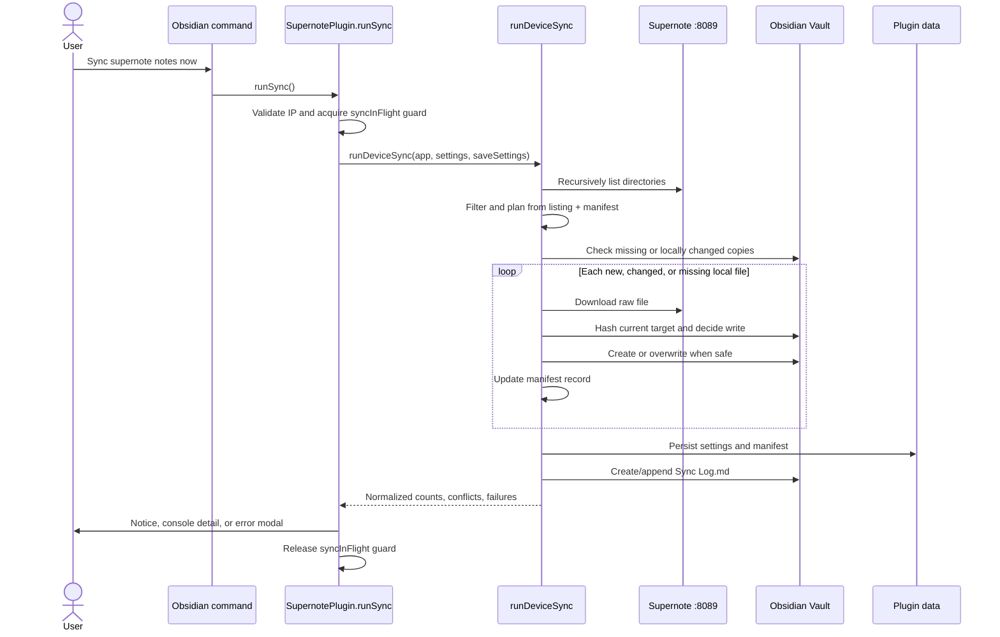
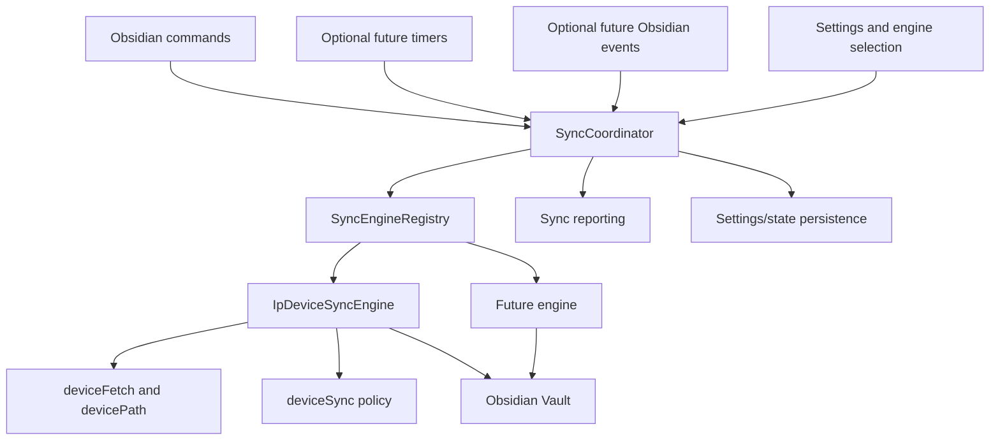

# Multi-Sync Plan

## Purpose

The goal of multi-sync is to let the plugin support more than one synchronization engine without duplicating or weakening the lifecycle behavior around synchronization. A user should eventually be able to choose which configured engine or engines run, while commands, scheduling, concurrency protection, notices, logging, settings persistence, and Obsidian lifecycle cleanup remain consistent.

This document first records the checked-out implementation of the existing local-network sync system. It then proposes an abstraction layer that can contain that behavior before a second engine is introduced.

This plan does not add another sync engine, change the current sync format, or enable automatic synchronization.

## Original IP-Based Sync Engine

### Scope and behavior

The original engine connects directly to a Supernote device's `Browse and Access` HTTP server at `http://<directConnectIP>:8089`. It recursively lists the device, selects trusted `.note` and `.spd` files, and mirrors their raw bytes into a configured vault folder.

The engine is intentionally a one-way, additive/update-only mirror:

- It copies raw `.note` and `.spd` files byte-for-byte. It does not render or convert them to Markdown, images, SVG, or PDF.
- It creates new vault files and updates previously synced files when the device listing reports a change.
- It restores a previously synced vault file if the local copy was deleted while the device copy remained unchanged.
- It never deletes a vault file because a device file disappeared or was renamed.
- It never overwrites a file that appears to have been edited locally since the engine last wrote it.
- It records conflicts and failures in `Sync Log.md` under the configured sync folder.
- It persists a manifest that is used for change detection and overwrite ownership.

Despite some older comments and planning documents using the term "auto-sync," the current `main` branch has no automatic IP sync timer, startup sync, or vault/workspace event that starts a sync. The current engine runs only through its Obsidian command.

### Settings that affect the engine

The settings are declared in `src/settings.ts` as part of `SupernotePluginSettings`. `DEFAULT_SETTINGS` supplies defaults, and `SupernotePlugin.loadSettings()` shallow-merges persisted plugin data over those defaults. `saveSettings()` writes the full settings object through Obsidian's `saveData()`.

| Setting | Default | IP sync role |
| --- | --- | --- |
| `directConnectIP` | `''` | Device IPv4 address. A sync cannot start when this is empty. This setting is shared with file browsing, uploads, date-based import, and screen mirroring; it is not owned exclusively by sync. The settings UI validates dotted-quad IPv4 input. |
| `syncFolder` | `'Supernote sync'` | Vault destination root. Device directories and raw filenames are mirrored below this path, and `Sync Log.md` is stored here. The engine uses deterministic paths instead of Obsidian's attachment-name uniquification. |
| `syncPathFiltersRaw` | `''` | Comma- or newline-separated device path patterns. Empty means all trusted `.note` and `.spd` files. `*` matches within one path segment, `**` crosses directory boundaries, and `?` matches one character. Matching considers decoded device path variants so human-readable paths containing spaces work. |
| `noteSyncState` | `{}` | Persisted manifest keyed by device URI. Each record stores device date and size, vault path, the hash of the bytes last written, and the last-sync timestamp. It drives both efficient change detection and the local-edit overwrite guard. |

The settings tab exposes two additional sync-related UI behaviors:

- The `Sync` heading groups `syncFolder`, `syncPathFiltersRaw`, and sync-history controls.
- `Forget sync history` replaces `noteSyncState` with `{}` and saves settings. On the next run, all in-scope files are reconsidered. An existing vault file is accepted only if it is byte-identical to the freshly downloaded device file; otherwise it remains protected as a conflict.

Settings that do not affect this engine include `importFormat`, `pageExportImageFormat`, `vectorInk`, `showExportButtons`, `invertColorsWhenDark`, and `fileBrowserSortOrder`. The sync scan has its own traversal and always copies original file bytes.

### Implementation files

#### `src/main.ts`

This is the plugin-level entry point and current sync controller.

- Declares the `syncInFlight` boolean used to reject overlapping runs.
- Registers command ID `sync-notes-from-device` with the visible name `Sync supernote notes now`.
- Implements `runSync()`, which validates that an IP is configured, enforces the in-flight guard, invokes `runDeviceSync()`, shows the result notice, and writes detailed conflicts/failures to the console.
- On a top-level failure, appends a failure entry to the sync log on a best-effort basis and opens `DirectConnectErrorModal`.
- Loads and saves the settings object that contains the engine configuration and manifest.

The command ID is a compatibility surface because users can bind hotkeys to it. A refactor should preserve `sync-notes-from-device` even if the visible command name or internal controller changes.

#### `src/syncEngine.ts`

This is the Obsidian-facing orchestration for one IP sync run.

- Calls `scanDeviceSupernoteTree()` to obtain all trusted syncable device files.
- Converts the scan into the minimal listing shape used by the pure planner.
- Parses path filters and calls `planSync()`.
- Checks locally stored copies of unchanged device files. Missing copies are moved back into the work queue for restoration.
- Downloads each new, changed, or locally deleted file using the longer transfer timeout.
- Maps device URIs to deterministic vault paths.
- Hashes incoming and existing bytes, then calls `decideWrite()` before any create or overwrite.
- Creates missing vault folders and writes files through the Obsidian Vault API.
- Updates `noteSyncState` only after a successful write.
- Checks unchanged files for local drift so local edits are reported even when the device copy has not changed.
- Saves settings once after the file-processing passes.
- Appends conflicts and per-file failures to `Sync Log.md`; a clean run still creates the log file so sync activity is discoverable.

Per-file download or write failures are isolated in the result and do not abort the rest of the run. Failures that occur before a per-file result can be produced, such as an unreachable device during the initial tree scan, escape to `main.ts` for top-level reporting.

#### `src/deviceSync.ts`

This file owns the pure, transport-independent policy for the current engine.

- Defines `DeviceNoteListing`, `SyncedNoteRecord`, `SyncManifest`, and `SyncPlan`.
- Parses the configured filter text and implements the supported glob subset.
- Classifies a device file as new, changed, or unchanged by comparing device URI, date, and size with the manifest.
- Partitions listings into `toSync`, `unchanged`, and `excluded`; it deliberately has no delete action.
- Maps a device URI to a stable vault path under `syncFolder` and sanitizes device-controlled path segments.
- Computes deterministic non-cryptographic content hashes used as fingerprints, not as a security boundary.
- Decides whether a target may be created, overwritten, or skipped as a conflict.
- Builds persisted manifest records.
- Formats the append-only conflict/failure log entries and computes the log path.

Keeping this policy independent of Obsidian is valuable and should be preserved. It allows the safety and change-detection rules to be tested without a vault or UI.

#### `src/FileListModal.ts`

The sync engine reuses device browsing functions from this file:

- `fetchSupernoteDirectory()` fetches and parses one `Browse and Access` directory listing.
- `scanDeviceSupernoteTree()` recursively traverses the device tree and returns `.note` and `.spd` files.
- A visited-path set prevents traversal loops.
- Listing entries are accepted only when the filename is plain and consistent with the URI leaf. This is a security boundary for all consumers that write device-supplied filenames into the vault.
- Directory display names are retained so spaces and literal plus signs can be reconstructed correctly.

The modal classes in this file are not themselves part of sync. Only the exported listing and scan functions are shared with the engine.

#### `src/deviceFetch.ts`

This file implements the IP transport used by the engine and other device features.

- Uses Obsidian's `requestUrl()` rather than browser `fetch()`, which is required for plain-HTTP LAN access from Obsidian mobile.
- Pins requests to `http://<ip>:8089` and encodes device-controlled path segments without allowing the path to replace the URL host.
- Applies a `3,000 ms` metadata timeout by default.
- Exposes a `120,000 ms` transfer timeout used for sync downloads.
- Normalizes network and timeout failures into actionable error messages.

This transport is shared infrastructure rather than sync policy. A future non-IP engine should not be required to depend on it.

#### `src/devicePath.ts`

This file normalizes, decodes, and encodes device path segments. It handles percent-encoding, Unicode normalization, non-breaking spaces, and the Supernote server's ambiguous use of `+` for spaces. Both scanning and deterministic vault-path generation depend on these rules.

This is also IP-device-specific infrastructure and should remain below the IP engine adapter.

### Current run sequence



### Timers, commands, and event hooks

#### Timers

There is no timer that schedules a sync.

The only timers in the active IP sync path are request deadlines inside `fetchFromDevice()`:

- Directory listings use `DEVICE_REQUEST_TIMEOUT_MS` (`3,000 ms`).
- File downloads use `DEVICE_TRANSFER_TIMEOUT_MS` (`120,000 ms`).
- Each request races `requestUrl()` against `window.setTimeout()` and clears the timeout when the request settles.

These are transport timeouts, not synchronization intervals.

#### Obsidian commands

One command triggers the engine:

| Command ID | Name | Behavior |
| --- | --- | --- |
| `sync-notes-from-device` | `Sync supernote notes now` | Calls `SupernotePlugin.runSync()` and returns immediately from the command callback while the async run continues. |

The command is registered during `SupernotePlugin.onload()`.

#### Obsidian lifecycle and event hooks

- `onload()` loads settings before registering the sync command.
- No sync is started from `onload()` or an Obsidian layout-ready callback.
- No `workspace` event starts or responds to a sync.
- No `vault` create, modify, delete, or rename event starts or updates sync state. Local drift is discovered by hashing files during the next manual run.
- No `registerInterval()` or sync-related `setInterval()` is present.
- `onunload()` does not have sync-specific cleanup because there is no scheduler or cancellable sync resource today. It only terminates the shared rendering worker pool.
- The settings UI's `Forget sync history` button is an `onClick` handler that clears the IP engine manifest. It changes how the next run plans work but does not start a run.

### Result and failure reporting

`DeviceSyncResult` currently exposes:

- `synced`
- `unchanged`
- `excluded`
- `skippedConflicts`
- `failed`

`main.ts` converts these fields into a single completion notice. Conflict paths and per-file failure objects are also written to the console. `syncEngine.ts` writes conflicts and failures to `Sync Log.md`. A top-level failure is logged and shown through `DirectConnectErrorModal`.

### Tests and verification surfaces

- `src/deviceSync.test.ts` tests filters, planning, deterministic paths, hashing, overwrite safety, manifest records, and log formatting.
- `src/syncEngine.test.ts` tests orchestration against an in-memory vault, including restoration of locally deleted files, local-edit conflicts, mixed result buckets, and per-file fault isolation.
- `src/FileListModal.test.ts`, `src/deviceFetch.test.ts`, and `src/devicePath.test.ts` cover listing trust, transport behavior, request-path security, and path normalization.
- `scripts/test-device-sync.mjs` and `scripts/test-device-sync.entry.ts` provide a real-device smoke test that exercises upload, listing, filtering, download, and byte-for-byte mirroring through the actual implementation.

These tests define important compatibility constraints for wrapping the current engine in an abstraction.

## Abstraction Layer

### Goals

The abstraction should:

- Preserve the current IP engine's behavior and persisted state before adding another engine.
- Allow one engine, several selected engines, or eventually all enabled engines to be run through the same coordinator.
- Keep transport, discovery, change detection, and engine-specific state inside each engine.
- Keep commands, scheduling, event-hook registration, concurrency, cancellation, notices, and lifecycle cleanup outside individual engines.
- Give all engines a common result shape without forcing them to use IP-specific concepts such as device URIs or `Sync Log.md`.
- Prevent state, log, and destination collisions between engines.
- Preserve existing command IDs, user hotkeys, settings values, manifest data, and safety behavior during migration.

### Proposed components



#### `SyncEngine`

An engine owns the behavior unique to one synchronization source or protocol. It should not register Obsidian commands, timers, or workspace/vault events directly.

A possible interface is:

```ts
export type SyncEngineId = string;

export type SyncTrigger =
    | { kind: 'manual'; commandId: string }
    | { kind: 'scheduled'; scheduleId: string }
    | { kind: 'startup' }
    | { kind: 'event'; eventId: string };

export interface SyncIssue {
    item?: string;
    message: string;
}

export interface SyncRunResult {
    engineId: SyncEngineId;
    synced: number;
    unchanged: number;
    excluded: number;
    conflicts: SyncIssue[];
    failures: SyncIssue[];
}

export interface SyncEngineRunContext<Config, State> {
    app: App;
    config: Readonly<Config>;
    state: Readonly<State>;
    trigger: SyncTrigger;
    signal: AbortSignal;
    persistState(nextState: State): Promise<void>;
}

export interface SyncEngine<Config, State> {
    readonly id: SyncEngineId;
    readonly name: string;
    getReadiness(config: Readonly<Config>): { ready: true } | { ready: false; reason: string };
    run(context: SyncEngineRunContext<Config, State>): Promise<SyncRunResult>;
    createEmptyState(): State;
}
```

The exact generic storage mechanism can be adjusted during implementation, but configuration and state should remain explicit and separate. The coordinator should not inspect an engine's manifest format.

#### `SyncEngineRegistration`

The registry needs an adapter between the generic coordinator and each engine's typed settings. This avoids passing the entire `SupernotePluginSettings` object into every engine.

```ts
export interface SyncEngineRegistration<Config, State> {
    engine: SyncEngine<Config, State>;
    readConfig(settings: SupernotePluginSettings): Config;
    readState(settings: SupernotePluginSettings): State;
    writeState(settings: SupernotePluginSettings, state: State): void;
    clearState?(settings: SupernotePluginSettings): void;
}
```

For the first migration, the IP registration can read the existing fields directly:

```ts
interface IpSyncConfig {
    ip: string;
    syncFolder: string;
    pathFiltersRaw: string;
}

type IpSyncState = SyncManifest;
```

`directConnectIP` should remain a shared plugin setting initially because non-sync device features use it. Moving it into an engine-only settings object would either duplicate configuration or break those features.

#### `SyncEngineRegistry`

The registry provides stable engine lookup and metadata for commands and settings UI.

Responsibilities:

- Reject duplicate engine IDs.
- Return engines in a deterministic display/run order.
- Resolve selected engine IDs to registrations.
- Expose readiness information for settings and commands.
- Keep registration centralized so a new engine does not require conditionals throughout `main.ts`.

The initial registry contains only `ip-device`.

#### `SyncCoordinator`

The coordinator owns behavior shared across engines and triggers.

Responsibilities:

- Run one engine by ID or a selected set of engines.
- Check readiness before a run and present configuration errors consistently.
- Serialize runs. The safest first implementation is one global in-flight lock because engines can share the vault and the same persisted settings object. Per-engine or per-destination locks can be considered later only if parallel runs are proven safe.
- Create an `AbortController` for a run and abort it during plugin unload. The current IP transport is not cancellable, so the first adapter may only observe cancellation between files until transport cancellation is added.
- Persist engine state through the registration adapter.
- Convert normalized results into notices and console output.
- Route engine-specific durable reports through a reporting hook rather than assuming every engine uses the IP engine's `Sync Log.md`.
- Register and dispose future timers or event subscriptions through Obsidian's `registerInterval()`, `registerEvent()`, and `register()` lifecycle helpers.

A possible coordinator surface is:

```ts
export interface SyncCoordinator {
    run(engineId: SyncEngineId, trigger: SyncTrigger): Promise<SyncRunResult | null>;
    runSelected(trigger: SyncTrigger): Promise<SyncRunResult[]>;
    isRunning(engineId?: SyncEngineId): boolean;
    clearEngineState(engineId: SyncEngineId): Promise<void>;
    dispose(): void;
}
```

`runSelected()` should execute engines sequentially at first. This avoids races in vault writes, settings saves, notices, and shared destination folders.

#### Trigger registration

Triggers should target engine IDs through the coordinator rather than calling engine implementations.

Initial command behavior:

- Preserve command ID `sync-notes-from-device` and route it to `coordinator.run('ip-device', { kind: 'manual', commandId: 'sync-notes-from-device' })`.
- Do not add a new command until it has distinct user value.
- When multiple engines exist, add a separate stable command such as `sync-selected-engines` for the selected set. Do not repurpose the existing IP-specific command in a way that changes a user's hotkey behavior unexpectedly.

Future scheduling behavior:

- Scheduling configuration belongs to the coordinator layer and refers to engine IDs.
- A scheduler should be registered with `plugin.registerInterval()` so Obsidian removes it on unload.
- The scheduler should call the same coordinator path as a manual command, including readiness checks, concurrency protection, normalized reporting, and state persistence.
- A timer firing while a run is active should coalesce or skip, not start a competing run.
- Startup sync and event-driven sync should also be modeled as `SyncTrigger` values and pass through the same coordinator.

There is no timer or event trigger to migrate today; the first abstraction change should preserve command-only behavior.

#### Reporting

Completion notices can be generic because the current result categories are broadly useful. Durable logs may be engine-specific.

A reporting extension can allow an engine to describe or write durable details without placing IP paths in the coordinator:

```ts
export interface SyncEngineReporter {
    reportResult(result: SyncRunResult): Promise<void>;
    reportFatalError(error: Error): Promise<void>;
}
```

For `ip-device`, this reporter would preserve `Sync Log.md` under `syncFolder` and the current `DirectConnectErrorModal` behavior. A future engine could use a different log location or include remote identifiers that do not map to device URIs.

### Settings and persisted state

The eventual settings model should distinguish shared coordinator settings from engine-specific configuration and state. One possible future shape is:

```ts
interface MultiSyncSettings {
    selectedEngineIds: SyncEngineId[];
    engines: {
        'ip-device': {
            enabled: boolean;
            syncFolder: string;
            pathFiltersRaw: string;
            state: SyncManifest;
        };
    };
}
```

This is a target shape, not a requirement for the first refactor. Initially, the IP registration should adapt the existing flat keys so the abstraction can be introduced without a settings migration.

When a nested model is introduced later:

- Add a settings schema version.
- Migrate `syncFolder`, `syncPathFiltersRaw`, and `noteSyncState` into the `ip-device` namespace exactly once.
- Keep `directConnectIP` shared unless all other device features are also moved to a reusable device connection profile.
- Do not discard the old manifest on migration; preserving overwrite ownership is a safety requirement.
- Keep a backup-compatible read path for one release if practical.
- Scope `Forget sync history` to a chosen engine rather than clearing every engine's state.

### Destination ownership and conflict rules

Multiple engines introduce a new class of collision that the current manifest cannot represent: two engines may map different source items to the same vault path.

The abstraction should therefore establish these rules before a second engine is added:

- Every persisted record is namespaced by engine ID.
- Every engine must produce deterministic destination paths or stable destination identities.
- An engine may overwrite only content it can prove that same engine previously wrote, unless the existing bytes are identical to the incoming bytes.
- Clearing one engine's history must not clear another engine's ownership records.
- Engines should use separate destination roots by default.
- If shared destination roots are allowed, the coordinator or a shared ownership service must detect cross-engine claims before writing.
- No engine should infer deletions merely because an item is absent from another engine's listing.

The existing IP overwrite rules in `decideWrite()` are the minimum safety baseline for future engines.

### Suggested implementation sequence

1. Extract the current plugin-level `runSync()` responsibilities into a `SyncCoordinator` with one registered engine, while preserving command-only behavior and the global in-flight guard.
2. Wrap `runDeviceSync()` as `IpDeviceSyncEngine` without changing `deviceSync.ts`, device transport, vault paths, settings keys, result notices, or log behavior.
3. Add coordinator and adapter tests proving the existing command invokes only `ip-device`, overlapping runs are rejected, state is persisted, and fatal errors still reach the IP reporter/modal path.
4. Route `Forget sync history` through `coordinator.clearEngineState('ip-device')` while keeping its current visible behavior.
5. Add engine selection settings only when there is a second engine or a concrete workflow that needs selection. Avoid UI and persisted-schema complexity before it is useful.
6. Before adding automatic triggers, define scheduling semantics, missed-run behavior, startup timing, unload cancellation, and how repeated triggers coalesce.
7. Add the second engine behind the registry, then add a `sync selected engines` command and any scheduling UI through the coordinator.

### Compatibility checklist for the first refactor

- `sync-notes-from-device` remains registered and continues to run only the IP engine.
- No sync occurs on startup, on an interval, or in response to vault/workspace events.
- `directConnectIP`, `syncFolder`, `syncPathFiltersRaw`, and `noteSyncState` retain their current persisted meanings.
- `.note` and `.spd` files are mirrored as raw bytes.
- Device deletions do not delete vault files.
- Locally edited files are never silently overwritten.
- Locally deleted, previously synced files are restored.
- Device listing and transfer timeouts remain `3 seconds` and `120 seconds` respectively.
- Concurrent runs remain blocked.
- The existing completion notice, error modal, console details, and `Sync Log.md` behavior remain available.
- Existing unit tests and the real-device smoke test continue to pass.

### Open design questions for the implementation phase

- Should multi-engine selection mean exactly one active engine, an ordered set of enabled engines, or both concepts?
- Should a combined run stop after one engine fails, or continue and present an aggregate result? Sequential continue-and-report is the likely default, but it should be explicit.
- Should durable logs stay per-engine, or should the coordinator also maintain a high-level aggregate run log?
- Can engines ever share a destination root, or should separate roots be enforced in settings?
- What scheduling model is needed: fixed interval, startup, event-driven, or a combination?
- Should cancellation be user-visible, and must transports support aborting an in-progress network request before automatic sync is introduced?