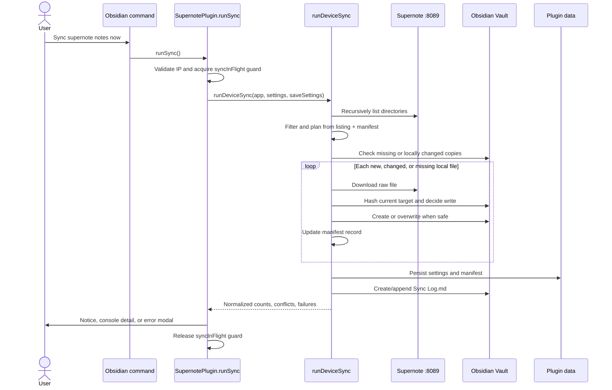
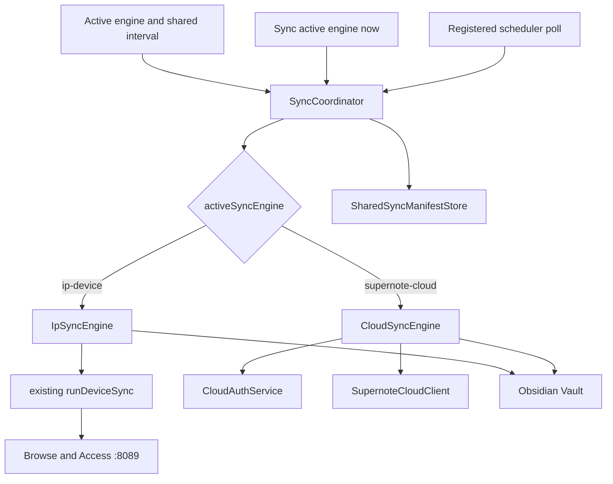

# Multi-Sync Design

## Purpose

The goal of multi-sync is to let the plugin contain more than one
synchronization engine while allowing exactly one engine to be active at a time.
A user selects either the IP engine or the Cloud engine; manual commands,
automatic scheduling, settings, and status operate only on that active engine.
The design should make future engines easy to add to the same selection without
introducing simultaneous multi-engine runs.

This document records the companion's current local-network sync system and
proposes an abstraction layer for selecting and operating one in-project engine
at a time. The planned Cloud engine's external protocol, evidence boundaries,
and user-observable behavior are defined by
[cloud-sync-design.md](cloud-sync-design.md).

This is a planning document. It does not yet add the Cloud engine, change the
current IP sync format, or enable automatic synchronization.

## Original IP-Based Sync Engine

### Scope and behavior

The original engine connects directly to a Supernote device's
`Browse and Access` HTTP server at `http://<directConnectIP>:8089`. It
recursively lists the device, selects trusted `.note` and `.spd` files, and
mirrors their raw bytes into a configured vault folder.

The engine is intentionally a one-way, additive/update-only mirror:

- It copies raw `.note` and `.spd` files byte-for-byte. It does not render or
  convert them to Markdown, images, SVG, or PDF.
- It creates new vault files and updates previously synced files when the device
  listing reports a change.
- It restores a previously synced vault file if the local copy was deleted while
  the device copy remained unchanged.
- It never deletes a vault file because a device file disappeared or was
  renamed.
- It never overwrites a file that appears to have been edited locally since the
  engine last wrote it.
- It records conflicts and failures in `Sync Log.md` under the configured sync
  folder.
- It persists a manifest that is used for change detection and overwrite
  ownership.

Despite some older comments and planning documents using the term "auto-sync,"
the current `main` branch has no automatic IP sync timer, startup sync, or
vault/workspace event that starts a sync. The current engine runs only through
its Obsidian command.

### Settings that affect the engine

The settings are declared in `src/settings.ts` as part of
`SupernotePluginSettings`. `DEFAULT_SETTINGS` supplies defaults, and
`SupernotePlugin.loadSettings()` shallow-merges persisted plugin data over those
defaults. `saveSettings()` writes the full settings object through Obsidian's
`saveData()`.

| Setting                 | Default            | IP sync role                                                                                                                                                                                                                                                                                                                                                                                                                                |
| ----------------------- | ------------------ | ------------------------------------------------------------------------------------------------------------------------------------------------------------------------------------------------------------------------------------------------------------------------------------------------------------------------------------------------------------------------------------------------------------------------------------------- |
| `directConnectIP`       | `''`               | Device IPv4 address. A sync cannot start when this is empty. This setting is shared with file browsing, uploads, date-based import, and screen mirroring; it is not owned exclusively by sync. The settings UI validates dotted-quad IPv4 input.                                                                                                                                                                                            |
| `syncFolder`            | `'Supernote sync'` | Shared vault destination root used by whichever sync engine is active. Device directories and raw filenames are mirrored below this path, and the IP `Sync Log.md` is stored here. The engine uses deterministic paths instead of Obsidian's attachment-name uniquification.                                                                                                                                                                |
| `syncPathFiltersRaw`    | `''`               | Currently stores comma- or newline-separated device path patterns. Under the multi-sync plan it becomes the shared **Path allowlist** for both engines without a data migration. Empty means every otherwise allowed file. `*` matches within one path segment, `**` crosses directory boundaries, and `?` matches one character. The IP engine continues considering decoded path variants so human-readable paths containing spaces work. |
| `syncFileExtensionsRaw` | `'.note, .spd'`    | Shared comma- or newline-separated file-extension allowlist. Entries are case-insensitive and may include or omit the leading dot. `*` explicitly includes every trusted regular file; blank includes none.                                                                                                                                                                                                                                 |
| `noteSyncState`         | `{}`               | Persisted manifest keyed by device URI. Each record stores device date and size, vault path, the hash of the bytes last written, and the last-sync timestamp. It drives both efficient change detection and the local-edit overwrite guard.                                                                                                                                                                                                 |

The settings tab exposes two additional sync-related UI behaviors:

- The `Sync` heading groups `syncFolder`, `syncPathFiltersRaw`, and sync-history
  controls.
- `Forget sync history` replaces `noteSyncState` with `{}` and saves settings.
  On the next run, all in-scope files are reconsidered. An existing vault file
  is accepted only if it is byte-identical to the freshly downloaded device
  file; otherwise it remains protected as a conflict.

Settings that do not affect this engine include `importFormat`,
`pageExportImageFormat`, `vectorInk`, `showExportButtons`,
`invertColorsWhenDark`, and `fileBrowserSortOrder`. The sync scan has its own
traversal and always copies original file bytes.

### Implementation files

#### `src/main.ts`

This is the plugin-level entry point and current sync controller.

- Declares the `syncInFlight` boolean used to reject overlapping runs.
- Registers command ID `sync-notes-from-device` with the visible name
  `Sync supernote notes now`.
- Implements `runSync()`, which validates that an IP is configured, enforces the
  in-flight guard, invokes `runDeviceSync()`, shows the result notice, and
  writes detailed conflicts/failures to the console.
- On a top-level failure, writes a failure entry to the sync log on a
  best-effort basis and opens `DirectConnectErrorModal`.
- Loads and saves the settings object that contains the engine configuration and
  manifest.

The command ID is a compatibility surface because users can bind hotkeys to it.
A refactor should preserve `sync-notes-from-device` even if the visible command
name or internal controller changes.

#### `src/syncEngine.ts`

This is the Obsidian-facing orchestration for one IP sync run.

- Calls `scanDeviceSupernoteTree()` to obtain all trusted syncable device files.
- Converts the scan into the minimal listing shape used by the pure planner.
- Parses path filters and calls `planSync()`.
- Checks locally stored copies of unchanged device files. Missing copies are
  moved back into the work queue for restoration.
- Downloads each new, changed, or locally deleted file using the longer transfer
  timeout.
- Maps device URIs to deterministic vault paths.
- Hashes incoming and existing bytes, then calls `decideWrite()` before any
  create or overwrite.
- Creates missing vault folders and writes files through the Obsidian Vault API.
- Updates `noteSyncState` only after a successful write.
- Checks unchanged files for local drift so local edits are reported even when
  the device copy has not changed.
- Saves settings once after the file-processing passes.
- Writes conflicts and per-file failures to `Sync Log.md`; a clean run still
  creates the log file so sync activity is discoverable.

Per-file download or write failures are isolated in the result and do not abort
the rest of the run. Failures that occur before a per-file result can be
produced, such as an unreachable device during the initial tree scan, escape to
`main.ts` for top-level reporting.

#### `src/deviceSync.ts`

This file owns the pure, transport-independent policy for the current engine.

- Defines `DeviceNoteListing`, `SyncedNoteRecord`, `SyncManifest`, and
  `SyncPlan`.
- Parses the configured filter text and implements the supported glob subset.
- Classifies a device file as new, changed, or unchanged by comparing device
  URI, date, and size with the manifest.
- Partitions listings into `toSync`, `unchanged`, and `excluded`; it
  deliberately has no delete action.
- Maps a device URI to a stable vault path under `syncFolder` and sanitizes
  device-controlled path segments.
- Computes deterministic non-cryptographic content hashes used as fingerprints,
  not as a security boundary.
- Decides whether a target may be created, overwritten, or skipped as a
  conflict.
- Builds persisted manifest records.
- Formats conflict/failure log entries and computes the log path.

Keeping this policy independent of Obsidian is valuable and should be preserved.
It allows the safety and change-detection rules to be tested without a vault or
UI.

#### `src/FileListModal.ts`

The sync engine reuses device browsing functions from this file:

- `fetchSupernoteDirectory()` fetches and parses one `Browse and Access`
  directory listing.
- `scanDeviceSupernoteTree()` recursively traverses the device tree and returns
  `.note` and `.spd` files.
- A visited-path set prevents traversal loops.
- Listing entries are accepted only when the filename is plain and consistent
  with the URI leaf. This is a security boundary for all consumers that write
  device-supplied filenames into the vault.
- Directory display names are retained so spaces and literal plus signs can be
  reconstructed correctly.

The modal classes in this file are not themselves part of sync. Only the
exported listing and scan functions are shared with the engine.

#### `src/deviceFetch.ts`

This file implements the IP transport used by the engine and other device
features.

- Uses Obsidian's `requestUrl()` rather than browser `fetch()`, which is
  required for plain-HTTP LAN access from Obsidian mobile.
- Pins requests to `http://<ip>:8089` and encodes device-controlled path
  segments without allowing the path to replace the URL host.
- Applies a `3,000 ms` metadata timeout by default.
- Exposes a `120,000 ms` transfer timeout used for sync downloads.
- Normalizes network and timeout failures into actionable error messages.

This transport is shared infrastructure rather than sync policy. A future non-IP
engine should not be required to depend on it.

#### `src/devicePath.ts`

This file normalizes, decodes, and encodes device path segments. It handles
percent-encoding, Unicode normalization, non-breaking spaces, and the Supernote
server's ambiguous use of `+` for spaces. Both scanning and deterministic
vault-path generation depend on these rules.

This is also IP-device-specific infrastructure and should remain below the IP
engine adapter.

### Current run sequence



### Timers, commands, and event hooks

#### Timers

There is no timer that schedules a sync.

The only timers in the active IP sync path are request deadlines inside
`fetchFromDevice()`:

- Directory listings use `DEVICE_REQUEST_TIMEOUT_MS` (`3,000 ms`).
- File downloads use `DEVICE_TRANSFER_TIMEOUT_MS` (`120,000 ms`).
- Each request races `requestUrl()` against `window.setTimeout()` and clears the
  timeout when the request settles.

These are transport timeouts, not synchronization intervals.

#### Obsidian commands

One command triggers the engine:

| Command ID               | Name                       | Behavior                                                                                                           |
| ------------------------ | -------------------------- | ------------------------------------------------------------------------------------------------------------------ |
| `sync-notes-from-device` | `Sync supernote notes now` | Calls `SupernotePlugin.runSync()` and returns immediately from the command callback while the async run continues. |

The command is registered during `SupernotePlugin.onload()`.

#### Obsidian lifecycle and event hooks

- `onload()` loads settings before registering the sync command.
- No sync is started from `onload()` or an Obsidian layout-ready callback.
- No `workspace` event starts or responds to a sync.
- No `vault` create, modify, delete, or rename event starts or updates sync
  state. Local drift is discovered by hashing files during the next manual run.
- No `registerInterval()` or sync-related `setInterval()` is present.
- `onunload()` does not have sync-specific cleanup because there is no scheduler
  or cancellable sync resource today. It only terminates the shared rendering
  worker pool.
- The settings UI's `Forget sync history` button is an `onClick` handler that
  clears the current IP manifest. Under the planned migration this becomes the
  shared history action. It changes how the next run plans work but does not
  start a run.

### Result and failure reporting

`DeviceSyncResult` currently exposes:

- `synced`
- `unchanged`
- `excluded`
- `skippedConflicts`
- `failed`

`main.ts` converts these fields into a single completion notice. Conflict paths
and per-file failure objects are also written to the console. `syncEngine.ts`
writes conflicts and failures to `Sync Log.md`. A top-level failure is logged
and shown through `DirectConnectErrorModal`. The final settings save and Sync
Log write occur outside the per-file failure isolation, so either can currently
turn an otherwise partially successful run into a top-level failure after vault
files have already been written. The IP wrapper should preserve that behavior
initially; changing its persistence boundary is separate hardening work.

### Tests and verification surfaces

- `src/deviceSync.test.ts` tests filters, planning, deterministic paths,
  hashing, overwrite safety, manifest records, and log formatting.
- `src/syncEngine.test.ts` tests orchestration against an in-memory vault,
  including restoration of locally deleted files, local-edit conflicts, mixed
  result buckets, and per-file fault isolation.
- `src/FileListModal.test.ts`, `src/deviceFetch.test.ts`, and
  `src/devicePath.test.ts` cover listing trust, transport behavior, request-path
  security, and path normalization.
- `scripts/test-device-sync.mjs` and `scripts/test-device-sync.entry.ts` provide
  a real-device smoke test that exercises upload, listing, filtering, download,
  and byte-for-byte mirroring through the actual implementation.

These tests define important compatibility constraints for wrapping the current
engine in an abstraction.

## Planned Cloud Sync Engine

The planned Cloud engine will be implemented in this repository from the
external contract in [cloud-sync-design.md](cloud-sync-design.md). That
specification is the sole authority for public endpoint facts, request and
response data, authentication flows, error boundaries, licensing attribution for
public protocol sources, and user-observable Cloud behavior.

The approved engine scope is:

- Email-based authentication, with verification-code support only when its
  complete public protocol is independently verified.
- Device-local session and account-binding state.
- Manual and shared-interval one-way Cloud-to-vault mirroring.
- Account-root inventory with the same path-mask syntax and configurable
  file-extension allowlist as the IP engine. Both engines default to `.note` and
  `.spd`, preserving the IP engine's current behavior until the user opts into
  additional file types.
- Download of new or changed files, checksum verification, local-edit
  protection, complete-inventory deletion gating, and Obsidian Trash for
  unchanged Cloud-deleted copies.
- Non-destructive handling of every protocol behavior that the specification
  marks as unknown.

The planned engine excludes remote writes or upload features.

## Abstraction Layer

### Product decisions

The architecture follows these constraints:

- Exactly one sync engine is active at a time.
- Both engines are implemented in `obsidian-supernote-companion`; there is no
  runtime engine discovery, dynamic registration, or combined run.
- The active engine is selected explicitly from a fixed settings dropdown.
- Manual and scheduled sync always target the active engine only.
- Future engines are added in code and become another explicit selector option.
- The Cloud engine is download-only. It does not upload in the first
  implementation.
- Both engines use one shared path allowlist and one shared configurable
  file-extension allowlist. The extension allowlist defaults to `.note` and
  `.spd`.
- Both engines use one shared destination root and one shared mirror manifest.
  The manifest records files managed by sync as a whole, not ownership by one
  engine. Engine-specific remote metadata is only a change-detection snapshot
  from the engine that last reconciled that entry.

The implementation plan uses these decisions. They were selected because no
answer was available during this planning pass and are collected again as review
checkpoints at the end:

- One shared automatic-sync interval applies to whichever engine is active.
- The Cloud engine scans from the Cloud account root and applies path masks to
  canonical full Cloud paths.
- After a complete Cloud scan, a managed in-scope file absent from Cloud is
  moved to Obsidian Trash only if its local copy still matches the shared
  manifest. A locally edited copy is protected.
- IP and Cloud use one shared destination root and one shared mirror state.
- The product assumes one user, one Supernote device, and one corresponding
  Cloud account. IP and Cloud are alternate transports for the same logical
  source tree, not independent authorities.

### Cloud specification boundary

[cloud-sync-design.md](cloud-sync-design.md) is the authoritative external
contract for the planned Cloud engine. This plan applies that contract to the
plugin's single-active-engine architecture.

Required Cloud behavior:

- Login and verification-code authentication with a device-local session token.
- Manual and interval-based one-way Cloud-to-vault mirroring.
- Remote checksum-based unchanged detection.
- Local checksum protection before overwrite or deletion.
- Complete-scan gating before destructive cleanup.
- Obsidian Trash for safe removal of unchanged Cloud-deleted files.
- Stable remote IDs and deterministic collision-safe vault paths.
- A versioned vault manifest with serialized/transactional persistence.
- Per-file failure isolation and a normalized completion summary.

Explicitly excluded:

- Upload and `Send to Supernote`.
- Cloud Activity infrastructure beyond what is needed for ordinary sync status
  and logging.
- Runtime integration with an external sync engine.

### Specification-driven implementation

Implementation must follow [cloud-sync-design.md](cloud-sync-design.md),
including its separation of documented facts, product requirements, assumptions,
and unknowns. Undocumented protocol behavior remains unavailable or
non-destructive until independently verified and recorded in that specification.

- Define this plugin's own interfaces, names, state format, tests, and control
  flow around the approved requirements.
- Use only the external endpoints and fields permitted by the specification.
- Preserve the specification's read-only remote boundary.
- Keep the public Apache-2.0 and MIT protocol-source attribution maintained in
  the specification.

### Architecture overview



There is no registry or discovery mechanism. Construction is static and
explicit:

```ts
const engines: Record<SyncEngineId, SyncEngine> = {
  "ip-device": ipSyncEngine,
  "supernote-cloud": cloudSyncEngine,
};
```

Adding a future engine requires adding its implementation, adding it to this
map, and adding its label to the settings dropdown. This is deliberate YAGNI:
there is no extension protocol until a real external extension use case exists.

### Common engine contract

```ts
export type SyncEngineId = "ip-device" | "supernote-cloud";

export type SyncTrigger =
  | { kind: "manual"; commandId: string }
  | { kind: "scheduled" };

export interface SyncReadiness {
  ready: boolean;
  reason?: string;
}

export interface SyncIssue {
  kind: "protected" | "failure" | "warning";
  item?: string;
  message: string;
}

export interface SyncRunResult {
  engineId: SyncEngineId;
  synced: number;
  unchanged: number;
  excluded: number;
  removed: number;
  issues: SyncIssue[];
}

export interface SyncEngine {
  readonly id: SyncEngineId;
  readonly name: string;
  getReadiness(): SyncReadiness;
  run(trigger: SyncTrigger): Promise<SyncRunResult>;
}
```

The interface contains only behavior needed by both planned engines. It does not
include upload, pairing, Automation, discovery, multiple selection,
cancellation, or generic capability flags.

### `SyncCoordinator`

The coordinator owns the behavior shared by both engines:

```ts
export interface SyncCoordinator {
  getActiveEngine(): SyncEngine;
  setActiveEngine(engineId: SyncEngineId): Promise<void>;
  runActive(trigger: SyncTrigger): Promise<SyncRunResult | null>;
  isRunning(): boolean;
  clearHistory(): Promise<void>;
}
```

Responsibilities:

- Resolve exactly one engine from `activeSyncEngine`.
- Reject an engine switch while a sync is running.
- Check readiness and present an engine-specific setup reason.
- Hold one global in-flight lock so manual and scheduled triggers cannot race.
- Invoke only the active engine.
- Produce one normalized Notice summary and preserve engine-specific durable
  logs.
- Own the shared manifest store and expose one shared `Forget sync history`
  action. Forgetting history preserves vault files and the Cloud account/root
  binding but relinquishes sync's per-file management records.
- On a dispatched run's completion, set `lastRunAt` to the completion time and
  set `lastRunOutcome` to `succeeded` when there are no issues, `attention` when
  the run completes with protected/per-file warning or failure issues, and
  `failed` when the engine throws or cannot produce a reliable result. A
  readiness rejection is not a run and does not replace the previous outcome.
- Switching engines preserves the shared manifest. It changes which source is
  consulted and which reconciliation policy applies; it does not migrate or
  transfer file ownership.

Because only one engine can run, there is no engine ordering, aggregate result,
cross-engine ownership broker, or continue-after-one-engine-fails policy.

### Shared scheduler

The shared coordinator owns one scheduler for the active engine; the plugin
registers its poll with Obsidian and routes due runs through the coordinator.

- Add a device-local `autoSyncMinutes` setting. `0` disables scheduling.
- Register one `60,000 ms` poll through `plugin.registerInterval()`.
- On each poll, compare the configured interval with the active engine's
  device-local last automatic-attempt timestamp.
- If due, call the same `coordinator.runActive({ kind: 'scheduled' })` path used
  by the manual command.
- Register/resume polling during `onload()` without unconditionally running a
  sync. On the first poll, use the active engine's persisted attempt timestamp:
  if a valid timestamp shows its configured interval elapsed while Obsidian was
  closed, dispatch one scheduled run through the coordinator. Otherwise, wait
  until due. This recovers one missed interval without treating plugin load as
  an independent sync trigger or initiating automatic setup/authentication
  flows.
- Persist `lastAutomaticAttemptAt[engineId]` immediately before dispatching a
  scheduled run, including one that later fails, so failures cannot retry every
  minute.
- A manual run does not change the automatic cadence.
- When scheduling is enabled, an engine is selected without a timestamp, or an
  invalid timestamp is loaded, initialize that engine's timestamp to the current
  time without running it. Its first automatic run becomes due after a full
  interval. Do not replay multiple missed intervals; at most one run is
  dispatched on startup, and the attempt timestamp is persisted before it.
- A timer firing during a run skips that poll; it does not queue or overlap a
  second run.
- Track last automatic-attempt timestamps by engine ID so switching engines does
  not make one engine inherit the other's interval history.
- Scheduled IP failures should use a Notice and durable log rather than opening
  a blocking modal. Manual IP failures retain `DirectConnectErrorModal`.

The interval is shared rather than configured separately per engine. Only the
currently selected engine is eligible to run.

### Settings and state model

#### Device-local execution state

Active execution choices should use device-local storage because Cloud login,
LAN reachability, and desired scheduling can differ between Obsidian devices:

```ts
interface SyncExecutionState {
  version: 1;
  activeSyncEngine: SyncEngineId;
  autoSyncMinutes: number;
  lastAutomaticAttemptAt: Partial<Record<SyncEngineId, string>>;
  lastRunAt: Partial<Record<SyncEngineId, string>>;
  lastRunOutcome: Partial<
    Record<SyncEngineId, "succeeded" | "attention" | "failed">
  >;
  cloudSessionToken: string | null;
  cloudAccountId: string | null;
}
```

The default active engine is `ip-device`, preserving existing behavior. The
Cloud email, password, and verification code are never persisted. Only the
resulting session token and stable account ID are stored locally. Token expiry
clears the token but retains the account ID needed to validate the shared
mirror's account binding. This state should use the plugin's device-local
storage abstraction, not synced `data.json`.

#### Persisted engine configuration

The existing IP fields retain their current meanings. The destination, path
allowlist, and file-extension allowlist are shared by every engine:

```ts
interface SupernotePluginSettings {
  // Shared sync configuration.
  syncFolder: string;
  syncPathFiltersRaw: string;
  syncFileExtensionsRaw: string;

  // IP transport configuration.
  directConnectIP: string;
}
```

The existing `syncFolder: 'Supernote sync'` remains the shared destination
without a data migration. `syncFileExtensionsRaw` defaults to `.note, .spd`, and
the existing `syncPathFiltersRaw` becomes the shared path allowlist. Existing
`noteSyncState` records migrate from plugin settings into the shared vault
manifest as IP-observed entries, after which `noteSyncState` is removed from
persisted settings.

Within the Sync section, the settings tab should show shared settings first,
then engine selection, then engine-specific settings:

- Shared destination folder.
- Shared automatic-sync interval.
- Shared path allowlist and allowed file extensions.
- Active sync engine dropdown.
- `Sync now` for the active engine.
- Active engine status and last outcome.
- One shared `Forget sync history` control.
- An IP configuration section with the existing IP controls.
- A Cloud configuration section with sign in/sign out, connection status, Cloud
  account state, and reset controls.

Inactive-engine settings remain editable so a user can configure an engine
before switching to it, but inactive engines cannot be run by their settings
buttons. Setup-only actions such as Cloud sign-in/sign-out, connection tests,
and editing masks are allowed while Cloud is inactive. They never change
`activeSyncEngine`; the user must select Cloud explicitly.

The shared destination remains editable. Once sync manages files, changing it
invokes one coordinator-owned, confirmed root-move workflow rather than merely
saving a new string:

1. Require that no sync is running, the source root exists, and the destination
   does not exist.
2. Persist one small pending-move record containing the old and new roots.
3. Rename the complete shared root once through the Obsidian Vault API.
4. Rewrite destination paths in the shared manifest plus the shared setting,
   then clear the pending record.

On startup, a pending move has only three supported states: old root only means
the rename did not happen; new root only means finalize the metadata update;
both or neither roots means stop sync with a protected error. There is no
per-file migration protocol, content copying, or general-purpose move framework
in the first implementation. Moving the root as a unit preserves locally edited
managed files and user-created content inside it. This also replaces the IP
engine's current behavior, where changing `syncFolder` can gradually split one
mirror across old and new roots.

preserve and report locally edited files, clear the shared manifest, and remove
Changing Cloud accounts is handled only from the interactive sign-in flow; there
is no standalone destructive reset control. When a verified sign-in returns a
different account ID from the account bound to the shared manifest, the user is
shown a confirmation before the session or mirror is changed. Cancellation
preserves the current session, binding, and files. Scheduled sync never prompts
or starts account-change cleanup.

After confirmation, cleanup is limited to Cloud-managed records under the
current sync root. Unchanged files that match the current path and extension
allowlists are moved to Obsidian Trash. Edited files, out-of-scope files,
unmanaged files, shared IP records, `Sync Log.md`, and `.supernote-sync` are
preserved; preserved managed records are removed from Cloud management and
reported so the new account cannot overwrite them. Each target is checkpointed
before Trash and rechecked before the mutation so an interrupted change can
resume safely. When cleanup finishes, the manifest is bound to the newly
verified account before its session is saved; a failed session save therefore
cannot let the old session claim the new mirror. A pending account change blocks
Cloud sync. Moving a destination does not change account binding or reset
history.

`Forget sync history` remains non-destructive: it relinquishes sync's per-file
management records without moving vault files or changing the Cloud account
binding. The exact handling of device-local last-run display state during
account change remains a product decision; current implementation retains it.

### Shared path and file-type allowlists

Move the transport-neutral filter logic from `src/deviceSync.ts` into a shared
module such as `src/sync/pathFilters.ts`:

- `parsePathFilters(raw)` keeps comma/newline input.
- `*` matches within one path segment.
- `**` crosses directory boundaries.
- `?` matches one character.
- An empty pattern list matches everything.
- Matching remains anchored to the complete source path.

Add shared file-extension allowlist parsing alongside the path logic:

- One comma- or newline-separated extension list applies to both engines.
- Entries are compared case-insensitively and may be entered with or without a
  leading dot.
- The shared list defaults to `.note` and `.spd`, so upgrading does not broaden
  the IP engine's existing scope automatically.
- `*` explicitly selects all trusted regular files. Clearing the field selects
  no file extensions; it must not silently broaden the scope.
- Directories and unsupported metadata entries are never downloadable file
  candidates regardless of the allowlist.

The settings and UI call `syncPathFiltersRaw` the **Path allowlist**, not the
device path allowlist. The IP engine compares each shared pattern against
decoded source-path variants. The Cloud engine compares the same patterns
against one normalized canonical Cloud path with a leading slash, for example
`/Note/Work/Journal.note`.

The first Cloud implementation scans the account root and filters the resulting
file inventory by both the shared full-path patterns and shared extension
allowlist. Traversal pruning based on filters can be added later if real
accounts show a performance need. Files outside either current filter are
`excluded`; changing a path mask or extension allowlist does not delete their
existing vault copies or manifest entries. Remote disappearance is determined
from the complete, unfiltered inventory first; a file moving from included to
excluded scope is therefore retained rather than misclassified as deleted.

### Custom dictionary boundary

The custom dictionary is not a sync setting. It rewrites recognized text only
when the plugin generates Markdown during import/export. Both sync engines copy
source file bytes unchanged and therefore have no recognized-text payload for
the coordinator to transform. The coordinator must not apply the dictionary to
raw mirrored files or include it in the `SyncEngine` contract. If a future sync
mode generates Markdown rather than mirroring source files, that would be a new
capability with its own explicit transformation contract.

### IP engine integration

`IpSyncEngine` is a thin wrapper around the existing implementation, not a
rewrite.

- Reuse `runDeviceSync()` and the pure policy in `deviceSync.ts`.
- Preserve `directConnectIP`, shared `syncFolder`, and `syncPathFiltersRaw`.
- Read and update the shared manifest instead of an IP-owned manifest. Existing
  `noteSyncState` records migrate to shared entries with IP source metadata.
- Add the shared `syncFileExtensionsRaw`, defaulting to `.note` and `.spd`.
  Refactor the device scan's currently hard-coded extension selection so
  additional trusted regular-file extensions can be selected without weakening
  its filename and path-validation boundary.
- Preserve additive/update-only semantics, local-edit protection, restoration of
  locally deleted managed files, `Sync Log.md`, and request timeouts.
- Replace direct `syncFolder` reassignment after the engine owns files with the
  shared destination-root rename workflow.
- Move plugin-level validation/result formatting from `runSync()` into the
  wrapper or coordinator so both manual and scheduled triggers share one path.
- Map `DeviceSyncResult` to the common result with `removed: 0`.
- The coordinator's shared history action clears shared manifest entries; the IP
  engine has no separate history to clear.

Automatic scheduling is new for the IP engine, but it does not alter the sync
algorithm. Only the trigger and scheduled-error presentation change.

The existing `sync-notes-from-device` command ID should remain registered for
saved-hotkey compatibility, but its `checkCallback` should make it available
only when `ip-device` is active. A new transport-neutral command such as
`sync-now` runs whichever engine is active.

### Specification-based Cloud engine

The Cloud engine is implemented inside this repository with its own names and
types. Suggested files:

- `src/cloudSync/cloudAuth.ts` - login, verification, logout, and local token
  state.
- `src/cloudSync/cloudClient.ts` - the minimum read-only Supernote Cloud HTTP
  operations: authenticate, list directories, obtain download metadata, and
  download bytes.
- `src/cloudSync/cloudTypes.ts` - independently defined response and domain
  types.
- `src/sync/syncManifest.ts` - shared versioned manifest, serialized writes, and
  transaction/recovery behavior used by both engines.
- `src/cloudSync/cloudSyncEngine.ts` - recursive inventory, filtering, planning,
  download, safe cleanup, and normalized results.
- `src/cloudSync/cloudSyncEngine.test.ts` and focused client/manifest tests.

#### Authentication workflow

1. The Cloud settings UI collects email and password and calls the read-only
   Cloud client login operation.
2. If verification is required, a modal collects the verification code and can
   resend it.
3. On success, persist only the session token in device-local execution state.
4. `getReadiness()` reports sign-in as the blocking reason when no token exists.
5. Authentication expiry clears the token and asks the user to sign in again.
6. Sign out clears the local token without modifying the shared manifest or
   vault files.
7. Record the authenticated account's stable ID. If a later login returns a
   different account ID while the shared manifest is bound to another account,
   require explicit interactive confirmation and perform the guarded account-
   change flow above. Cancellation changes nothing; scheduled sync never
   prompts. Never apply one account's complete-scan deletions to another
   account's files.

#### One-way mirror workflow

1. Verify authentication and Cloud destination readiness.
2. Open the shared manifest and verify that its optional Cloud account binding
   and destination root match the authenticated account and current
   configuration.
3. Recursively inventory the Cloud account from its root. Track whether the
   entire scan completed successfully.
4. Retain the complete remote-ID inventory, then normalize each full Cloud path
   and apply the shared path and extension allowlists for transfer planning.
5. Plan deterministic vault paths below the shared `syncFolder`, including
   stable disambiguation for case-insensitive collisions.
6. For each in-scope file, compare remote identity/checksum metadata with the
   shared manifest and verify that the local file still matches the last written
   hash.
7. Skip unchanged files, protect locally edited files, and download new or
   changed files.
8. When an existing remote ID moves, rename its locally unchanged managed file
   to the new deterministic path. If the old local file was edited or the new
   destination cannot be adopted safely, preserve it and report a protected item
   rather than creating or deleting ambiguous duplicates.
9. Before each create, overwrite, move, adoption, or cleanup, persist a pending
   operation record containing its previous manifest entry, intended entry,
   affected paths, and expected before/after hashes. Perform the vault mutation,
   atomically checkpoint the intended shared manifest, then clear the pending
   record. Isolate ordinary per-file transfer failures so other files continue,
   but stop the run if the shared manifest cannot be advanced safely.
10. Only after a complete inventory, find every managed in-scope shared entry
    absent from Cloud, including entries last observed through IP. Move an
    unchanged local copy to Obsidian Trash and remove its manifest entry.
    Protect a locally edited copy and report it instead.
11. Return a normalized result and update per-engine last-run status.

Cloud files outside the current path filters are neither downloaded nor removed.
The Cloud engine never uploads or modifies remote content.

#### Shared mirror manifest

Store the shared manifest in a reserved hidden directory below the destination
root, for example `<syncFolder>/.supernote-sync/`. Its versioned header binds
the mirror to the configured root and, after Cloud is used, to one account:

```ts
interface SharedSyncManifest {
  version: 1;
  destinationRoot: string;
  cloudAccountFingerprint: string | null;
  entries: Record<string, SharedSyncManifestEntry>;
}
```

Each entry is keyed by normalized vault path and records what sync last wrote.
The optional source snapshot belongs to whichever engine most recently
reconciled that file and is replaceable when the user switches engines:

```ts
interface SharedSyncManifestEntry {
  vaultPath: string;
  contentHash: string;
  lastSyncedAt: string;
  source:
    | {
      engineId: "ip-device";
      sourcePath: string;
      deviceDate: string;
      deviceSize: number;
    }
    | {
      engineId: "supernote-cloud";
      sourcePath: string;
      remoteId: string;
      remoteChecksum: string;
      remoteUpdatedAt: number;
    };
}
```

The source snapshot is an optimization, not ownership. If the active engine
cannot compare its inventory with an entry's current snapshot, it downloads or
otherwise obtains enough evidence to compare source bytes with `contentHash`. An
identical file replaces the source snapshot without rewriting the vault file. A
different source file follows the active engine's normal local-edit guard before
overwrite. Thus the first run after switching engines may perform more downloads
but needs no ownership migration.

Each manifest or pending-operation checkpoint writes a sibling temporary file,
validates the complete JSON, and atomically replaces its primary file where the
adapter supports it. A pending operation is durable before its vault mutation.
On startup, recover it by comparing actual paths/hashes with its before/after
states: commit the intended entry when the mutation completed, restore the
previous entry when it did not start, and stop with a protected error when the
state is ambiguous. This applies to creates, overwrites, moves, adoptions, and
Trash cleanup; recovery is not limited to previously unowned files. A later run
may adopt an unowned file only after downloading or hashing the expected bytes
and proving them identical; a non-identical existing file is protected. This is
the full per-file durability model for the first implementation.

#### Concurrent manifest updates

The coordinator serializes runs within one plugin instance, but the same vault
may be open on more than one device. The manifest therefore does not contain an
owner-device ID and does not enforce an exclusive writer. Manifest persistence
uses an independently implemented revision-aware transaction:

- Serialize writes within one plugin instance.
- Retain the baseline manifest and its vault revision when a run begins.
- Before commit, read the latest visible manifest when its revision changed.
- Three-way merge the baseline, this run's result, and the latest visible
  manifest by normalized vault path.
- Preserve latest fields that this run did not change and preserve this run's
  fields when the latest manifest still matches the baseline.
- If both sides changed the same managed entry incompatibly, stop with a
  protected conflict instead of choosing a winner or performing further cleanup.

This is reconciliation, not a distributed lock. Two offline devices can act
before either sees the other's changes. Local-content hashes, pending-operation
recovery, complete-inventory deletion gates, and protected conflicts remain the
safety boundary when later synchronization exposes an ambiguous state.

The shared `Forget sync history` action deletes shared entries and pending
operation files only after confirming no run is active. It retains the
destination/account header, vault files, durable logs, authentication, and
last-run display state. The next run may re-adopt byte-identical files and
protects non-identical files. Because history establishes which files are
sync-managed, Cloud performs no deletion of pre-existing local files until they
have been adopted into the new manifest. Changing Cloud accounts is instead the
confirmed sign-in flow defined above; it cleans only unchanged, in-scope Cloud
records, preserves IP history and all protected/out-of-scope items, and binds
the verified target account when cleanup is complete. Current implementation
retains per-engine last-run display state through this change.

All Cloud-controlled paths must be normalized and proven to remain descendants
of `syncFolder`. Reject absolute paths, empty/`.`/`..` segments, embedded
separators, control characters, and names that collide with the reserved
`.supernote-sync` metadata directory after case folding and platform
normalization. Collision disambiguation must happen before the descendant check.

### Commands, timers, and hooks

#### Commands

| Command ID               | Behavior                                                      |
| ------------------------ | ------------------------------------------------------------- |
| `sync-now`               | Runs the active engine manually.                              |
| `sync-notes-from-device` | Legacy IP command; enabled only when the IP engine is active. |

A separate Cloud-only sync command is unnecessary. The active engine selector
and generic command are the product surface.

#### Timers

- One coordinator-owned, registered `60,000 ms` poll checks the shared interval
  and active engine. On startup, its first poll dispatches at most one run if a
  valid persisted timestamp shows that engine is overdue; it never runs
  unconditionally on load.
- There are no engine-specific scheduler timers.

#### Obsidian hooks

- `onload()` loads persisted settings and device-local execution state,
  constructs both engines and the coordinator, registers commands/settings, and
  starts the scheduler poll.
- `onunload()` relies on Obsidian to remove the registered interval and disposes
  any Cloud client resources.
- No workspace or vault event initiates synchronization.
- Changing the active engine updates readiness/status UI but does not
  automatically run it.

### Reporting and errors

The plugin formats a shared completion Notice from `SyncRunResult` and reports
both engines to `<syncFolder>/Sync Log.md`, labeled by engine and bounded by the
configured history count. Clean IP runs create the log without appending an
entry. Both engines log protected and failed file paths; Cloud log entries also
contain counts and allowlisted failure/warning categories, never raw Cloud
errors, account data, credentials, tokens, or signed URLs. The former proposal
for a separate Cloud log under `.supernote-sync` is superseded. The shared log
and `.supernote-sync` are reserved against Cloud writes and cleanup even with a
`*` extension allowlist.

- Manual setup/readiness failures can open the relevant settings or modal.
- Scheduled failures use non-blocking Notices and durable logs; they never open
  login or direct-connect modals automatically.
- Protected files are attention items, not fatal errors.

A full Activity subsystem is out of scope until ordinary Notices and durable
logs prove insufficient.

#### Shared sync log retention (implemented)

- In the Sync settings group, add shared `Sync log` (on by default) and
  `History count` (configurable positive integer, default `8`) controls for both
  engines. Describe the latter: "Number of sync log entries to keep." Display
  `History count` only while `Sync log` is enabled, preserving its saved value
  when hidden. Turning logging off prevents log creation and writes, including
  whole-run failures, but does not delete an existing log or suppress Notices.
  Turning it back on resumes at the existing shared log.
- A history entry is an H2 section in the shared log, normally one reportable
  run or whole-run failure, not an individual file line or a clean run. Keep the
  newest eight H2 sections by default across both engines, including older IP
  entries. Preserve content before the first H2; user-written H2 sections count
  toward the limit and may be trimmed. Retention applies when logging resumes,
  the limit changes, or a new entry is written. New entries appear above older
  ones, after any preamble; trimming removes entries from the bottom. Existing
  oldest-first logs with ordered timestamp headings are reordered when touched.
  A malformed or unwritable log must not change the sync result or bypass
  protected-file safeguards.
- Automatic sync remains off by default, with its existing 15-minute default
  interval. Do not overwrite a user's saved 5-minute (or other valid) choice.
  Eight entries spaced 15 minutes apart span 105 minutes from oldest to newest;
  at 5-minute spacing they span 35 minutes. Clean runs do not consume log
  entries, so the limit is not a time guarantee.

### Manifest and safety invariants

- Only the active engine can run.
- A global coordinator lock prevents overlapping manual/scheduled runs.
- IP and Cloud share one destination root and one mirror manifest.
- A manifest entry means the sync system manages that vault file; it does not
  assign permanent ownership to the engine recorded in its source snapshot.
- The active engine may overwrite or remove only files the shared manifest
  proves sync wrote or adopted and that remain unchanged locally.
- Identical incoming and existing bytes may be adopted safely after history is
  cleared. Non-identical unowned files are protected.
- IP never propagates source deletions.
- Cloud is authoritative while active. After a complete, stable inventory it may
  move any unchanged, managed, in-scope file absent from Cloud to Obsidian
  Trash, including a file last observed through IP.
- Excluded paths are never interpreted as deleted paths.
- Switching engines preserves the shared manifest. A source snapshot from the
  other engine is re-baselined when needed and then replaced by the active
  engine's snapshot.
- Authentication secrets never enter synced plugin data or logs.
- No remote write API is exposed by the Cloud engine.
- A shared manifest with a Cloud account binding is valid only for that account
  and its recorded destination root.
- IP runs preserve the Cloud account fingerprint. Only a confirmed account
  change in interactive Cloud sign-in can replace that binding.

### Implementation tracking

Implementation sequencing, completion status, and focused verification are
maintained in [multi-sync-plan.md](multi-sync-plan.md). This design remains the
architecture and behavior constraint for that work.
